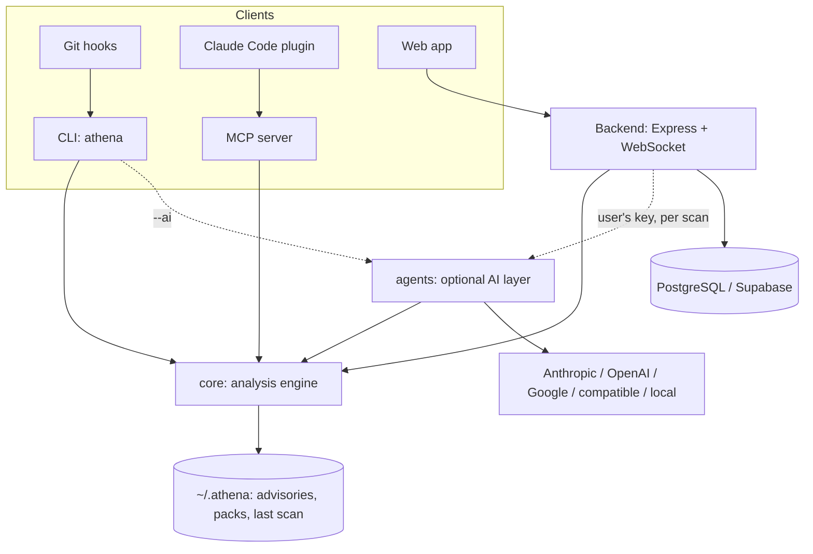
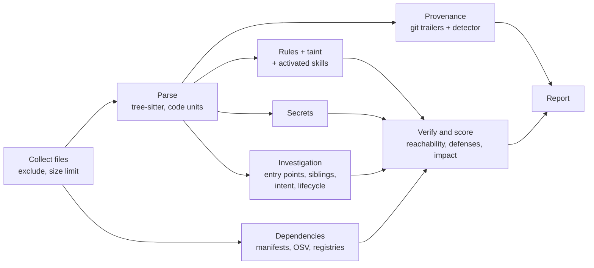
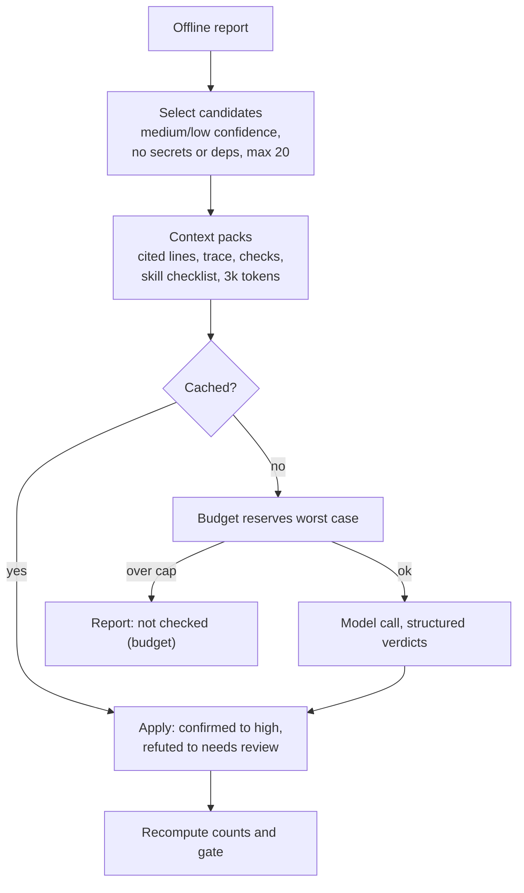
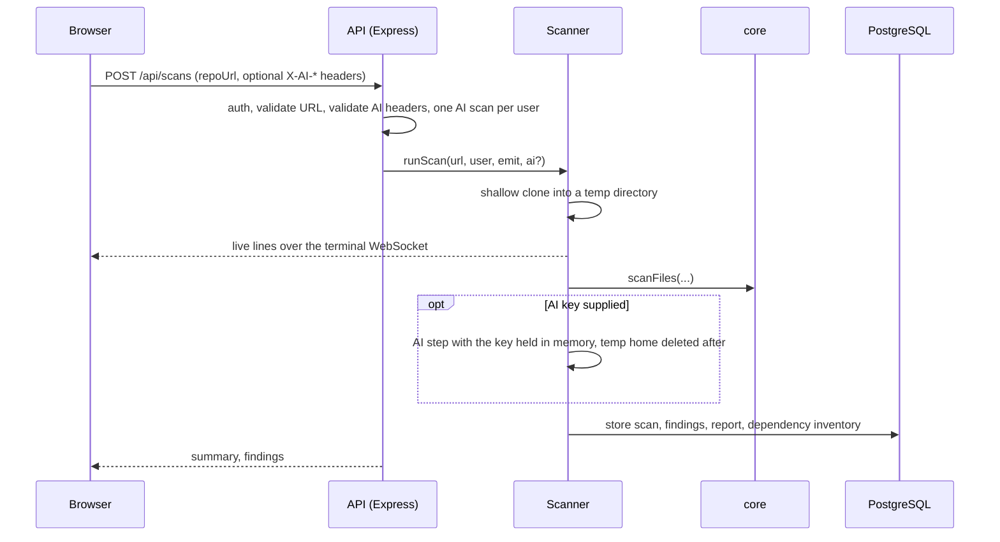

# Athena: System Design

> Describes the system as of CLI release 0.3.0. It replaces the 2.0 document, which predates tree-sitter, the investigation engine, dependency intelligence, skills, the AI layer and the review, MCP and plugin deliveries.

## 1. Purpose and scope

AI-written code reaches production with less review than human code. It tends to carry leaked credentials, invented packages and APIs, injection paths and insecure defaults that look fine to a syntax check. Athena finds those problems and estimates how much of a codebase was machine-written, so review effort goes where the risk is.

In scope: nine language families (JavaScript/TypeScript, Python, Java, C#, C/C++, Go, Rust, PHP, Shell); a CLI, git gates, an MCP server, a Claude Code plugin and a web app; an optional, user-funded AI verification layer.

Out of scope: running the scanned code, automatic fixes (patch suggestions are written for a person to apply), and anything that needs an account to use locally.

## 2. Principles

1. **Offline first.** Every finding the offline engine can decide is decided offline. No telemetry; scanning sends nothing anywhere.
2. **Say what was not checked.** Coverage gaps (skipped files, unavailable checks, stale advisory data, findings the AI cap left unchecked) are part of every report. A failure to look is never reported as "clean".
3. **Confidence over volume.** Each finding carries a confidence from reachability, defenses and impact. `low` ones are "needs review" and never block.
4. **The AI layer is a verifier, not a scanner.** It only sees what the offline engine was unsure about, under hard caps the user sets, with the user's own key.
5. **Untrusted input everywhere.** Repository text, advisories, skills and web uploads are data, never instructions.
6. **Graceful degradation.** A missing network, ESLint, git history or key reduces coverage and says so; it does not fail the scan.

## 3. Architecture

| Package | Role |
|---|---|
| `core` | The analysis engine: parsing, rules, taint, secrets, dependencies, provenance, skills, investigation, review filtering, report formats, advisory updates. No network use except dependency lookups and `athena update`. |
| `agents` | The optional AI layer: providers, key handling, budget, verify, hunt and deep modes. Depends on `core`; `core` never depends on it. |
| `cli` | Commands, git hooks, the MCP server, terminal output. Bundles `core` and `agents` into one file. |
| `backend` | HTTP API, live terminal, auth, scan storage, alert job, bring-your-own-key AI scans. |
| `frontend` | The web interface. |
| `plugins/athena`, `skills/athena-security` | Claude Code plugin and the open Agent Skills package. |

## 4. The scan pipeline (`core/src/engine.ts`)

1. **Collect.** Files are selected by extension or shebang, minus excluded paths and files over the size limit. Skipped files are recorded for coverage.
2. **Parse.** One pooled tree-sitter parser per language produces code units (functions and methods) with metadata. A file with a syntax error is marked `parse-failed`; its readable parts are still analyzed.
3. **Provenance.** *Recorded* lines come from git history (co-author trailers, agent authors) and are a floor. *Estimated* lines come from `athena-detect-fast` where a language meets the release targets, otherwise from a labelled style heuristic. Results are aggregated by lines and shown as a range with the method.
4. **Rules and taint.** Rule packs (plus active skills) match calls, lines and files. The taint engine follows sources (request parameters, argv, `$_GET`) through variables and helpers, and across files for JavaScript/TypeScript and Python, to sinks, stopping at sanitizers, parameterized queries and path-prefix checks. Findings carry the path.
5. **Secrets.** Provider patterns, connection strings, private keys and entropy-scored generic credentials in source and config files. Findings are redacted at the source.
6. **Dependencies.** Manifests and lockfiles are read for every supported ecosystem; OSV advisories (with KEV and EPSS), registry existence, typosquat, deprecation, release-age and install-script checks run in a separate Dependencies section. Registry failures become coverage gaps.
7. **Investigation.** The offline analogue of a reviewer: entry points and their auth guards, sibling conformity (the route missing the check its neighbours have), intent versus code, lifecycles, error paths and races.
8. **Verify and score.** Every finding is checked for reachability from an entry point, defenses on the path and impact. The result is a confidence (`high`, `medium`, `low`) and a priority (severity × exposure × confidence). `high` and `medium` count toward the gate.
9. **Report.** Terminal, JSON, JSONL, SARIF, Markdown, CycloneDX. The gate verdict is `BLOCKED`, `PASS` or `PASS (incomplete)` against `--fail-on`; known-exploited vulnerabilities block at any severity.

## 4a. Local learning

After a scan, `core/src/learning` collects **trusted labels** from the scan itself (units at least 80% recorded as AI-written; units whose every code line predates 2021-06-01 per git blame; units a person marked, matched by code hash), merges them into a per-repository store of numbers (hash, base AI probability, the 35 dense style features), and, when at least 30 labels with 10 of each class exist and the label set changed, trains a small ridge-regularised logistic adjustment on `logit(base probability)` plus repo-standardised style features. The base probability is whatever the scan uses: the fast detector where it is enabled for the language, otherwise the heuristic score. The adjustment is clipped to +-0.25 and is adopted only if it lowers log-loss on a deterministic stratified 20% hold-out and does not reduce AI recall or raise human false positives by more than one point on a bundled 2,000-unit check set (`core/models/check-set.bin`, exported from the benchmark's held-out test split by `core/src/ml/export-check-set.ts`). Partial scans (for example staged files) learn from the accumulated samples, so they never overwrite a better adjustment. State is `~/.athena/learning/<repoKey>.json` (mode 0600, atomic writes), keyed by the canonical path. `--no-learning` and `"learning": false` bypass training and application. The report states whether the estimate was tuned and how many units changed.

Limitations: human labels are code from before mid-2021 and AI labels are recent, so a repository can still teach the model "old style versus new style"; the guardrails limit the damage but do not remove this. With the heuristic as the base (every language except JavaScript) scores rarely approach the decision boundary, so tuning there seldom changes a unit's classification.

## 5. Skills and learned rules

A skill is a folder with `SKILL.md` and declarative data (`rules.json`, `taint.json`). Only the name and description are loaded up front. A skill activates when the project has a matching dependency or import, then contributes rules, sources, sinks and guidance. Skills contain no code; every regular expression is checked before loading and third-party patterns run under a time budget. `athena skills test` runs each skill's vulnerable and safe fixtures.

`athena variants <id> --save` and AI deep mode derive a rule from one confirmed finding (the sink call and the shape of its unsafe argument), preview the other matches, refuse rules that match more than 50 places, and store the rule in `.athena/learned-rules.json`, which every later offline scan applies.

## 6. Keeping data current

`athena update` syncs the OSV database incrementally per ecosystem, CISA KEV and EPSS into `~/.athena`, and fetches the latest rule and skill pack from the project's GitHub releases. A pack is accepted only if its Ed25519 signature and SHA-256 verify, it contains data only, and every rule passes its own fixtures; otherwise the previous pack stays active and `--rollback` is available. A background update starts after a scan when data is more than 24 hours old (never blocking the scan); data older than 7 days is reported as a coverage gap. `athena alerts` and a daily backend job compare each stored dependency inventory with current data.

## 7. Review, gates and agent delivery

- **`athena review`** takes a change (`--staged`, `--uncommitted`, `--range`, `--base`), runs the scan, and keeps only findings on changed lines; issues elsewhere in a touched function are listed as existing and not counted. Renames are followed and binary files skipped with a note.
- **Hooks.** `athena init` writes pre-commit (`athena check --staged`) and optional pre-push hooks, honours `core.hooksPath`, detects Husky, lefthook and the pre-commit framework (printing a snippet instead of editing), and never overwrites a foreign hook without `--force`.
- **MCP server.** `athena mcp` exposes scan, check, review, explain, provenance, dependencies, API existence, codebase map, taint paths, symbol and caller search and skills over stdio. Paths are confined to the starting directory, results are paginated and redacted, and the only write tool (`athena_add_learned_rule`) needs `confirm: true`. It never calls an AI model.
- **Claude Code plugin** bundles the MCP server, the `athena-security` skill (map, trace, verify under reachability, defenses and impact), a researcher and a verifier agent, `/athena-scan` and `/athena-review`, and hooks that check edited files.

## 8. The AI layer (`agents/`)

| Mode | What it adds |
|---|---|
| `verify` | Batches of 5 candidates behind an identical cached prefix; confirmed becomes `high`, refuted becomes `low` "needs review"; results cached per candidate (pack, provider, model, prompt version). |
| `hunt` | Also ranks components (exposure × findings × AI-written share) and lets a read-only, path-confined agent explore the top 3 for missed issues. Its findings must cite real lines, start at low confidence and are then verified. |
| `deep` | Adds a threat model, researchers per weakness category, a three-voter panel (reachability-first, defenses-first, impact-first; 2 of 3 decided in code), learned rules from confirmed findings and, with `--suggest-fixes`, patches written to `.athena/patches/` after a second reviewer call. Requires an explicit `--budget` and confirmation; non-interactive Anthropic runs use the Message Batches API. |

**Spend control.** `BudgetTracker` reserves the worst case (the full prompt at the uncached rate plus the maximum output) before each call, counts calls in flight, and releases the difference once real usage is known. Defaults are $0.25 per run and $1.00 per day (local-midnight rollover, ledger in `~/.athena/usage.json`); models with no known price use token caps. When the next call could exceed a cap, the run stops and the report lists what was not checked.

**Privacy and safety.** The first AI run in a repository shows what is sent and where, and asks once. Secrets and dependency findings are never sent. Repository text is wrapped and neutralised, the system prompt states it is untrusted, and a verdict is accepted only from structured output. Keys come from the environment or a 0600 file, are redacted from errors and are never logged. Agents get only read-only tools confined to the project (symlinks resolved).

**Providers.** A neutral `ModelProvider` interface (`chat`, `countTokens`, capabilities, optional `chatBatch`) with adapters for Anthropic, OpenAI, Google and OpenAI-compatible endpoints. Remote compatible endpoints must be https; local endpoints (Ollama, LM Studio) cost nothing.

**Status.** Adapters are verified against the vendors' type definitions and scripted providers; they have not been exercised against live APIs in this repository, and the verification benchmark (`bench/ai-verify`) has not been run because it spends money. Defaults for non-Anthropic providers are therefore left to the user (`--model`).

## 9. Web platform

- **Sources.** Public https repositories (shallow clone, 120 s limit) or an uploaded folder or ZIP (200 MB limit, traversal-safe extraction, heavy directories skipped). Workspaces are temporary and deleted after the scan.
- **Terminal.** `/ws/terminal` accepts only `help`, `clear`, `scan`, `scans`, `findings` and `upload`; scan output streams to the matching session.
- **Auth.** Supabase Auth with GitHub and Google OAuth plus Bearer sessions; scans, findings and alerts are scoped to the user.
- **Reports.** Findings by severity with code snippets and redacted secrets, Markdown and PDF export, a dashboard of history and risk metrics, and "new vulnerabilities since your last scan" from a daily job.
- **Bring your own key.** The Settings page keeps the key in the browser tab (sessionStorage) and sends it as headers only on a scan the user starts with AI on. The backend requires a spend cap of at most $1.00 per scan and returns the consent text before scanning, allows only hosted providers and allowlisted https hosts (no local models, no arbitrary endpoints, so the server cannot be pointed at internal hosts), runs one AI scan per user at a time, scrubs the key from errors and logs, and never stores it.
- **Data model.** `users`, `auth_sessions`, `scans`, `scan_findings`, `scan_reports`, `scan_inventories`, `scan_alerts`, `scan_terminal_lines`, `job_locks` (schema in `docs/supabase/schema.sql`). The AI result summary is returned with the scan response and is not persisted; updated confidence and evidence on findings are.

## 10. Output and user interface

The CLI prints in the Claude Code style: `⏺` opens a section or finding, `⎿` hangs its detail, an orange rotating glyph shows progress on an interactive terminal only. Machine formats (JSON, SARIF) and piped output are unchanged. The web interface uses a warm-paper theme with Geist and Geist Mono and an ASCII canvas hero.

## 11. Known limits

- AI-provenance estimates are probabilistic. The trained detector (`athena-detect-fast` 0.2.1) is enabled for JavaScript and TypeScript: both met the release targets (human false-positive rate ≤ 5%, F1 ≥ 0.85, at least 5 repositories per class, and the same false-positive limit on 2022-era human code; JavaScript scored F1 0.94, 3.0% and 4.2%; TypeScript F1 0.86, 4.3% and 4.9%, a thin margin). Python fails on a 13% false-positive rate on older human code; the other languages fail on too few distinct test repositories or too little AI data and use a labelled low-confidence style heuristic. The human data is from before mid-2022 and the AI data from 2025 onward, so an era effect cannot be fully excluded, and no verified-human recent code exists to test with. See `docs/athena-bench/RESULTS.md`.
- Static-analysis recall was measured against a hand-verified, partial answer key; precision is not yet measured (`docs/athena-bench/SAST.md`).
- Detected secrets are not verified with their provider.
- Hallucinated-API checks need the package installed with type declarations.
- The AI layer is untested against live provider APIs, and prompt-injection tests cover framing, not real-model robustness.
- Batch-API usage is accounted at full price against caps (the real cost is about half), which errs on the safe side.
