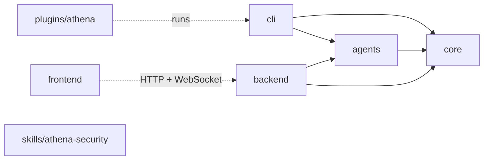
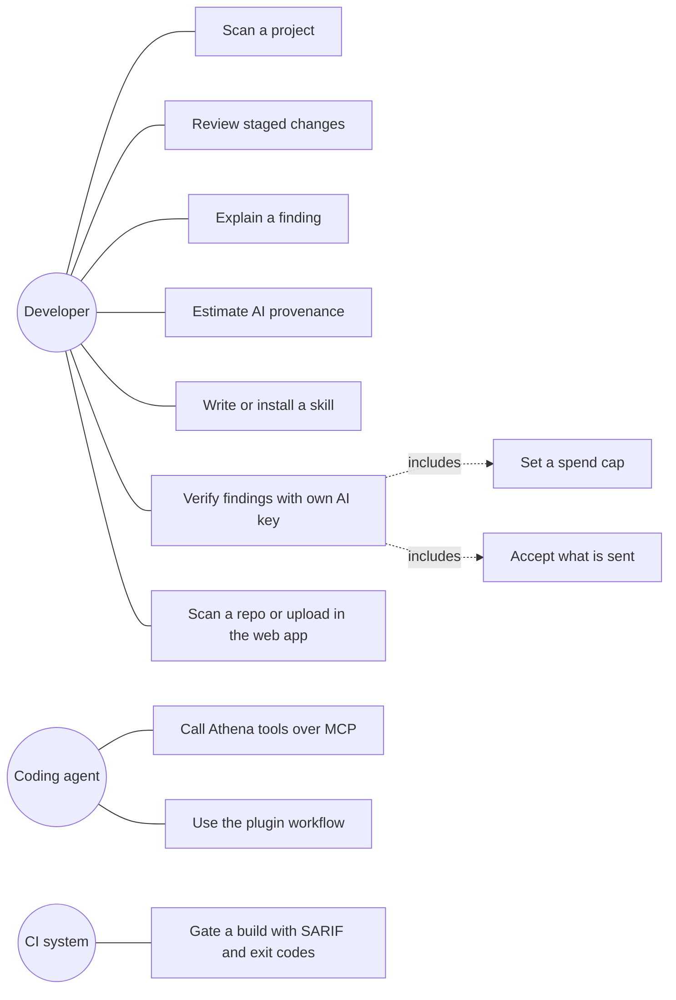
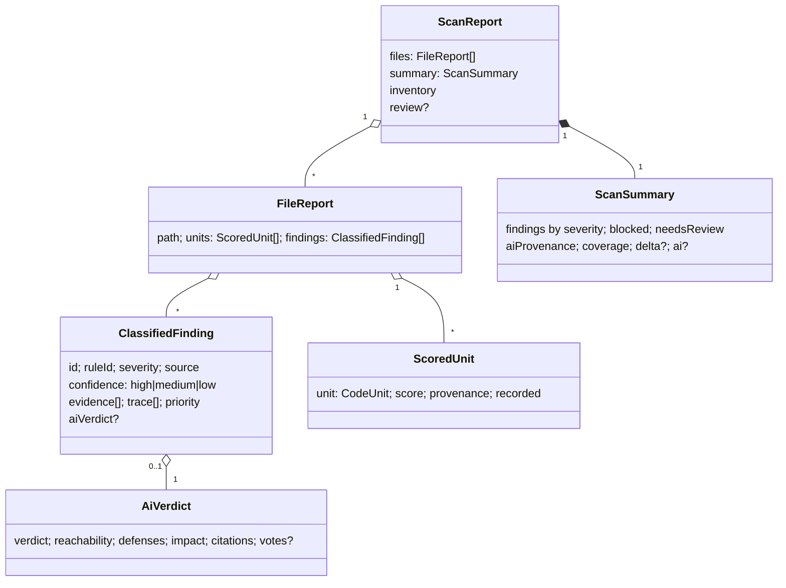
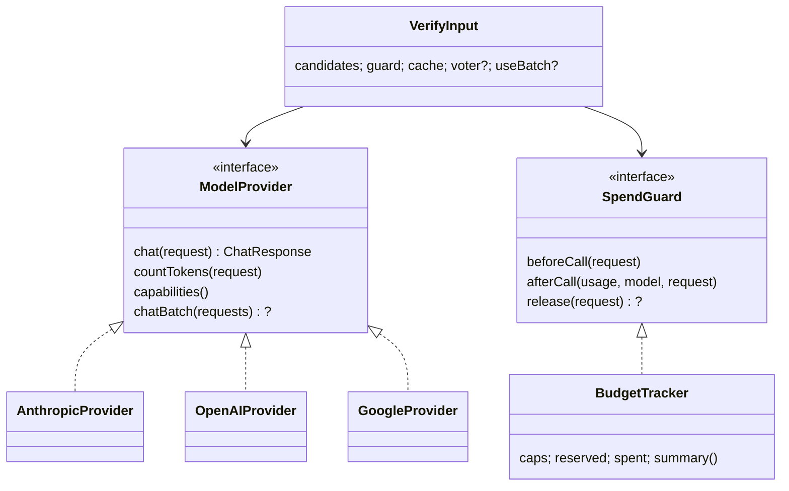
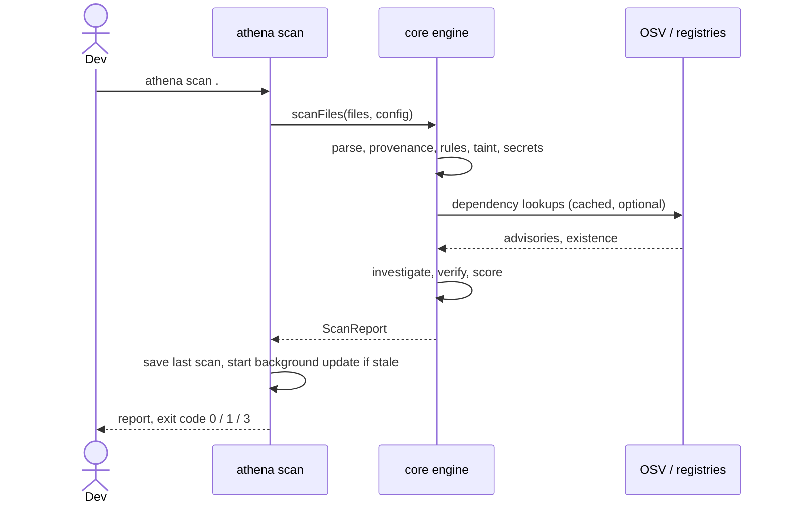
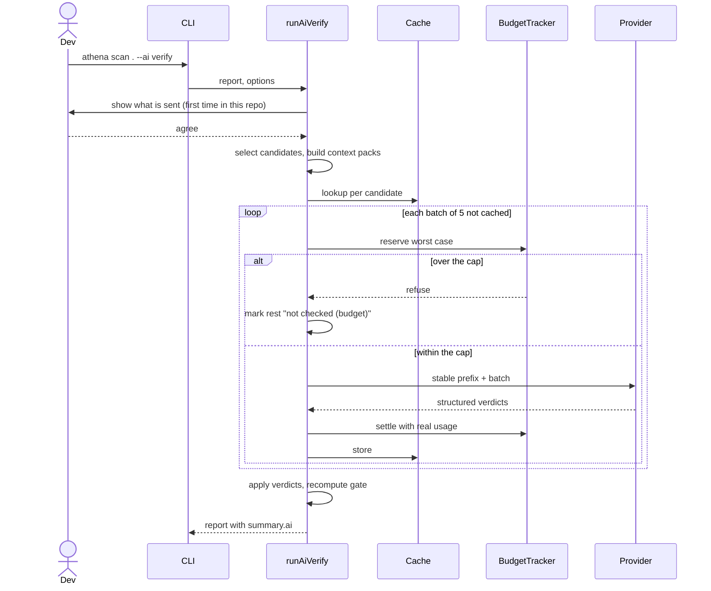
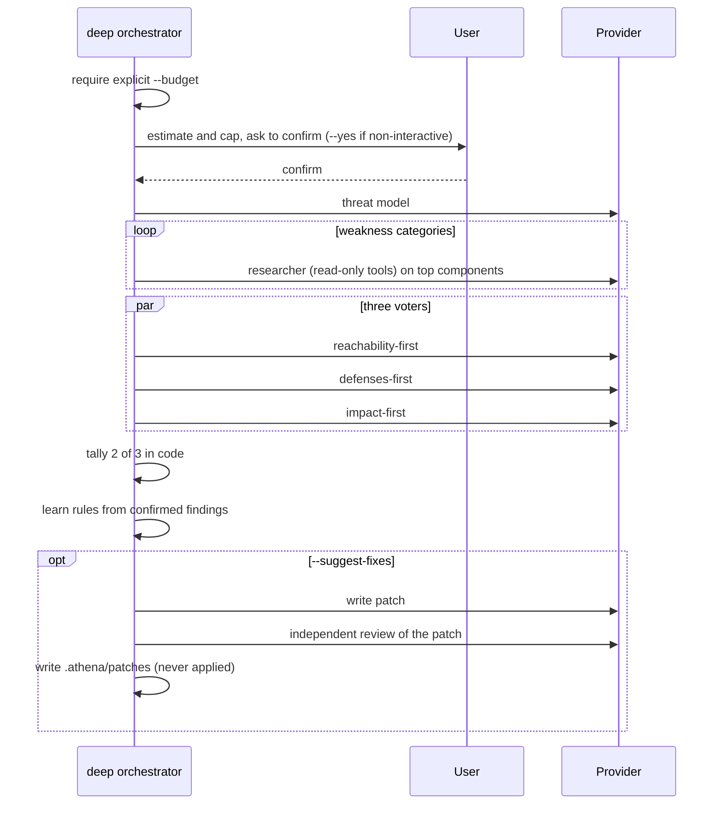
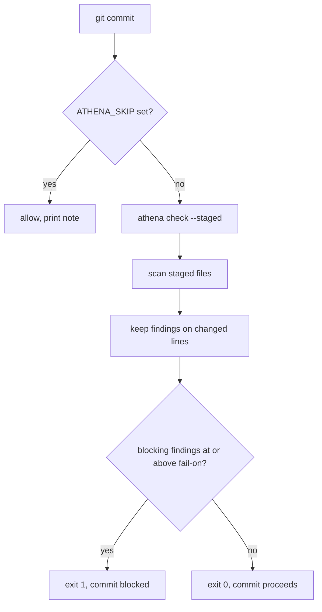
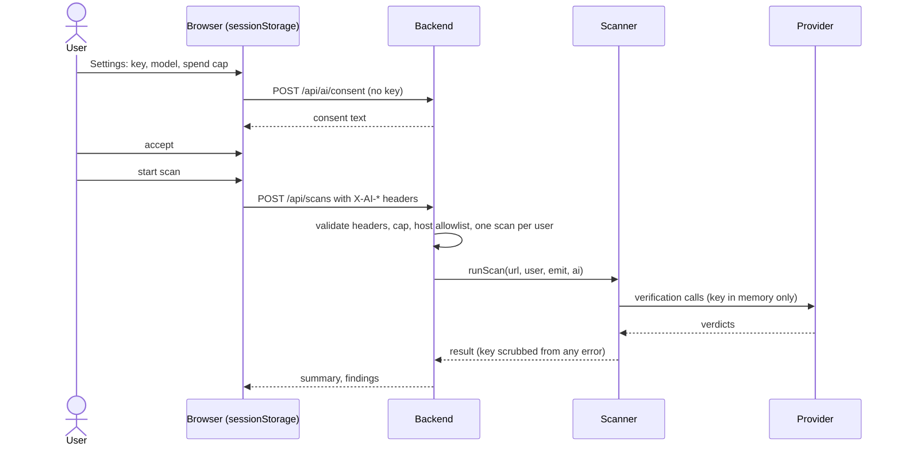
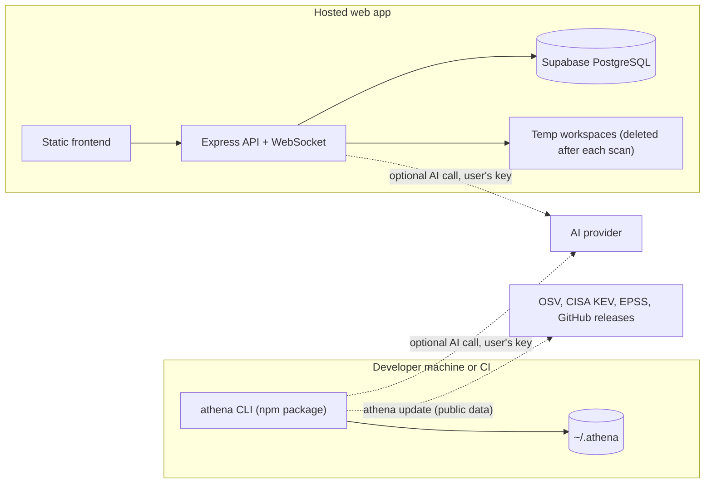

# Athena: UML Diagrams

> Current as of CLI release 0.3.0. The earlier set (Semgrep paths, TypeScript Compiler API parser) was removed. Prose is in [SYSTEM_DESIGN.md](SYSTEM_DESIGN.md).

## 1. Package dependencies

`core` depends on nothing in the repository. `agents` is optional for every client: the CLI loads it only when `--ai` is used.

## 2. Use cases

## 3. Core types

## 4. AI layer types

OpenAI-compatible services reuse `OpenAIProvider` with a different base URL.

## 5. Sequence: scan from the CLI

## 6. Sequence: AI verification

## 7. Sequence: deep mode

Non-interactive Anthropic runs send the voters through the Message Batches API.

## 8. Activity: review and pre-commit gate

`athena review` runs the same steps for `--uncommitted`, `--range` or `--base` and can print Markdown for a pull request.

## 9. Sequence: web scan with a bring-your-own key

## 10. Deployment

